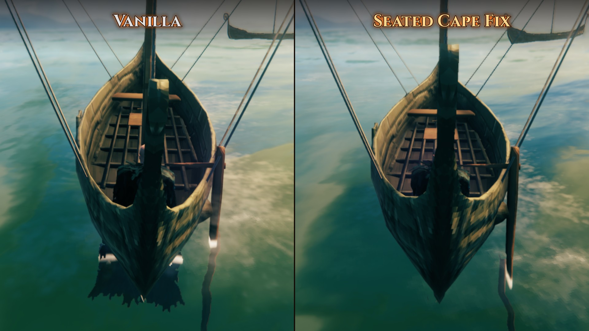
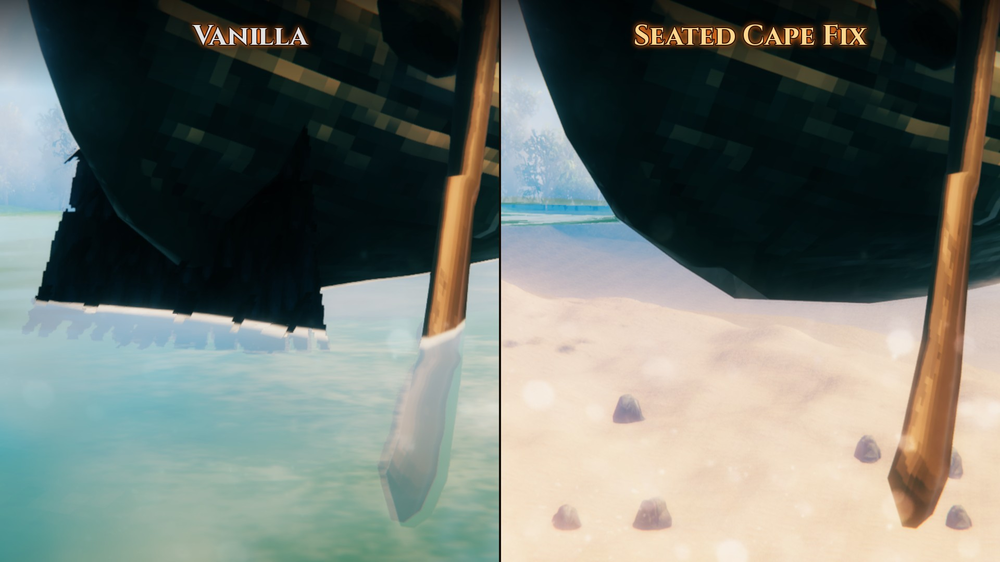
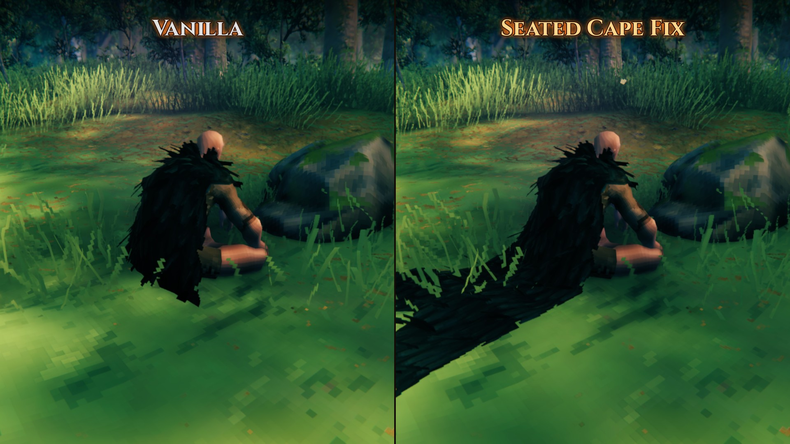
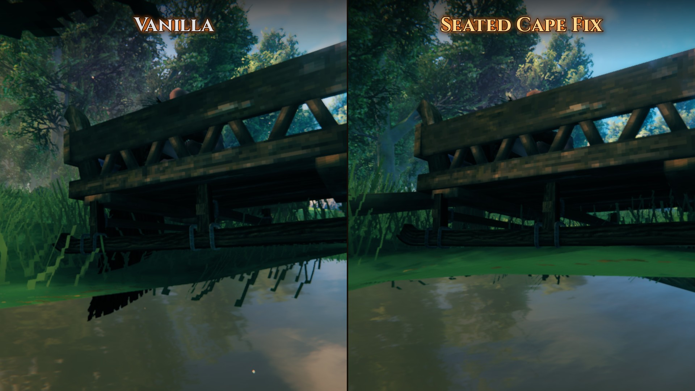
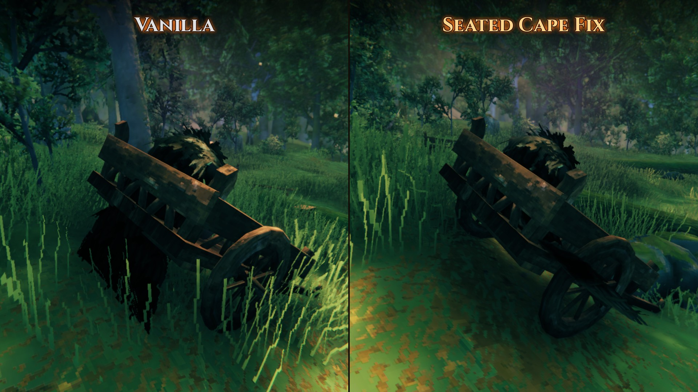

# SeatedCapeFix

Your cape no longer clips through the seat when you sit. At the helm of a karve or a longship, on a bench or a stool, in a cart or a sled, sitting on the ground, and on seats from other mods: the cape lies on what you sit on and falls over its edge, the way a cape does.

**100% client-side.** Nothing to install on the server: it works on any dedicated server, on a friend's local host and in single player. You see the fix on every player, whether they have the mod or not.

## What it does

| What you sit on                                      | Examples                                   | The cape                                                    |
|------------------------------------------------------|--------------------------------------------|-------------------------------------------------------------|
| A seat that ends behind you                          | bench, stool, log, sea chest               | lies on the seat and falls over its back edge               |
| A floor with a wall behind                           | longship helm, Winter Sled, cart with seat | lies on the floor and gathers in front of the wall          |
| A floor that goes on                                 | a ship's deck, the ground                  | lies on it                                                  |
| A hull around you                                    | karve helm (the stern narrows behind you)  | lies on the floor between the sides of the hull             |
| A chair or a throne with a backrest right behind you | chair, throne, sofa                        | unchanged: it goes behind the backrest, which hides it best |

It needs no list of seats: it reads the shape of whatever you sit on, so ships and furniture from other mods work too (the ones tested are listed under [Installation](#installation)).

## Good to know

- **Multiplayer:** with the mod you see every player's cape fixed; players without it see the vanilla game, also on you.
- **Riding** a lox, an asksvin or a modded mount counts as sitting, but there is no seat to measure on a creature's back: the cape only gets a short edge behind you and looks about as in the vanilla game.
- Standing at the mast or at the prow, or lying down, isn't sitting: the mod leaves the cape alone there.
- A few seats are shaped in ways it can't fully read yet: the barrel of OdinsBarrelRide (the cape can still poke through its side) and the slatted sides of a Winter Sled (the tips of a long cape can show between the slats).
- The cape keeps its own physics: it still swings, flutters in the wind and follows you. The mod only adds something for it to lie on.

## Configuration

`BepInEx/config/rgeraskin.SeatedCapeFix.cfg`. [Configuration Manager](https://thunderstore.io/c/valheim/p/Azumatt/Official_BepInEx_ConfigurationManager/) (F1) changes it in game, and a change takes effect at once.

| Section | Key       | Default | Description                                             |
|---------|-----------|---------|---------------------------------------------------------|
| General | `Enabled` | `true`  | The fix on or off (for comparing with the vanilla game) |
| Debug   | `Log`     | `false` | Log the seat found for each sitting player              |

## Installation

Needs only [BepInExPack Valheim](https://thunderstore.io/c/valheim/p/denikson/BepInExPack_Valheim/). Install with a mod manager, or put `SeatedCapeFix.dll` into `BepInEx/plugins`. Only you need it: not the server, not the other players.

Tested on Valheim 1.0.21 with BepInExPack 5.4.2351 on Windows and macOS: in single player, in player-hosted games and on dedicated servers, with capes of every tier, on ships at anchor and sailing through a storm. Tested with the ships and seats of these mods:

- [BoatAdditions](https://thunderstore.io/c/valheim/p/blacks7ar/BoatAdditions/): its eight boats, at the helm and on the benches
- [OdinShip](https://thunderstore.io/c/valheim/p/Marlthon/OdinShip/): its cargo ships, warship and canoes
- [OdinsBarrelRide](https://thunderstore.io/c/valheim/p/OdinPlus/OdinsBarrelRide/): the barrel and the duck
- [OdinHorse](https://thunderstore.io/c/valheim/p/OdinPlus/OdinHorse/): the horse, the horse cart and its chair
- [Winter Sled](https://thunderstore.io/c/valheim/p/rgeraskin/WinterSled/): the sled and the vanilla cart's seat
- [FineWoodFurnitures](https://thunderstore.io/c/valheim/p/blacks7ar/FineWoodFurnitures/): benches, chairs and stools
- [Balrond Furniture Reborn](https://thunderstore.io/c/valheim/p/Balrond/balrond_furniture_reborn/): benches, chairs, stools and sofas

## How it works

Capes are simulated cloth. Cloth on a character collides only with the character's own body, never with the world, so when you sit down nothing stops it from dropping straight through the seat, the deck or the hull under you.

While a player sits, the mod measures what is under and behind them with a few short raycasts, works out which of the shapes above it is, and gives the cape matching invisible colliders: rows along a seat's edge, or planes for a floor, a wall and a hull's sides. Other players' capes are simulated on your computer too, so the fix shows on them as well.

It costs nothing you can notice: a sitting player is measured twice a second (about 0.1 ms on a desktop PC), only while you can see them, and nothing at all while everyone stands.

## Bugs and ideas

Found a bug or a seat where the cape still pokes through, or have an idea? Tell me on the [GitHub issues page](https://github.com/rgeraskin/valheim-seated-cape-fix/issues) or in the chat for my mods, on [Discord](https://discord.gg/hxpuTQF2Bb) or [Telegram](https://t.me/+NwReoOS9x7hhYjgy), ideally with a screenshot and the name of the mod the seat comes from.

## Development

Built with dotnet from [mise](https://mise.jdx.dev): `mise run build`, `mise run test`, `mise run package` (the mod's zip). The details and the in-game test harness are described in [CLAUDE.md](https://github.com/rgeraskin/valheim-seated-cape-fix/blob/master/CLAUDE.md).

## Credits

- The title on the mod's images is set in [Cinzel](https://fonts.google.com/specimen/Cinzel) (Natanael Gama, SIL Open Font License).
- The icon's title is set in [Lilita One](https://fonts.google.com/specimen/Lilita+One) (Juan Montoreano, SIL Open Font License).

## Made with AI

This mod — code, tests, images and this text — was made entirely with AI, and tested in the game.

## License

MIT, see [LICENSE](https://github.com/rgeraskin/valheim-seated-cape-fix/blob/master/LICENSE). Source code: [github.com/rgeraskin/valheim-seated-cape-fix](https://github.com/rgeraskin/valheim-seated-cape-fix).
